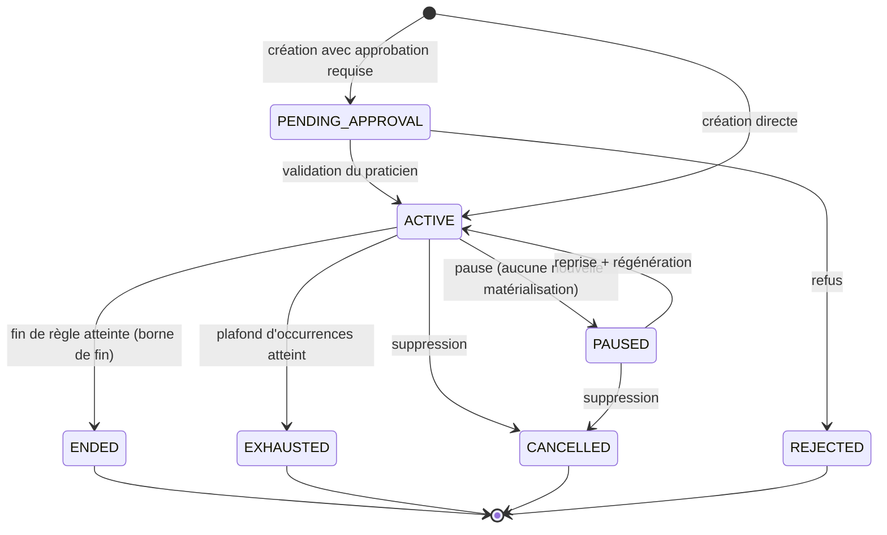
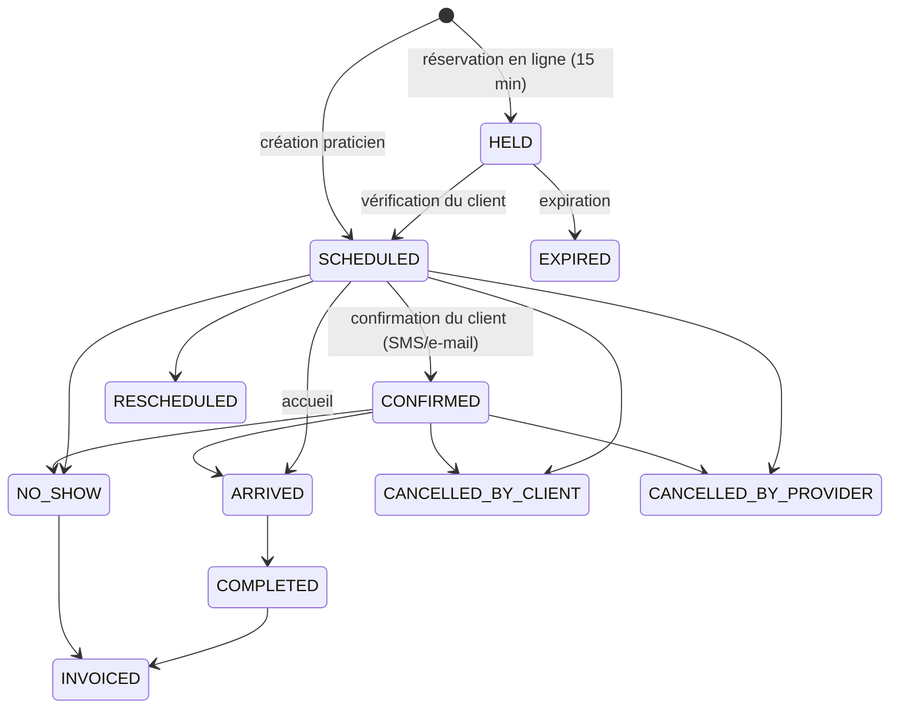

# 07 — API et schémas des rendez-vous récurrents

**Document** : 07 / 10 · **Version** 1.0 · **Date** : 12 novembre 2026 · **Statut** : contrat
**Base d'URL** : `https://api.myrdv.app/v1` · **Format** : JSON (UTF-8), dates ISO-8601
**Authentification** : OAuth 2.0 (authorization code + PKCE) ou clé d'API d'organisation
**Normativité** : les règles de comportement renvoient au [document 06](06-moteur-rdv-recurrents.md)
(préfixes `R-xx`). Schéma de validation : [`schemas/recurrence-rule.schema.json`](../schemas/recurrence-rule.schema.json).

---

## 1. Conventions

| Sujet | Convention |
|---|---|
| Versionnage | Préfixe de chemin `/v1` ; les évolutions compatibles n'incrémentent pas la version ; les ruptures introduisent `/v2` avec 12 mois de support |
| Identifiants | ULID (26 caractères, triables) — jamais d'entier séquentiel exposé |
| Dates | `YYYY-MM-DD` pour les dates locales ; `HH:MM` pour les heures murales ; RFC 3339 avec offset pour les instants |
| Fuseaux | Nom IANA obligatoire (`Europe/Paris`) — jamais d'abréviation (`CET`, `EST`) |
| Pagination | `?limit=50&cursor=<ulid>` ; réponse `{data, nextCursor, hasMore}` |
| Tri | `?sort=startAt,-createdAt` |
| Idempotence | En-tête `Idempotency-Key` (UUID v4) obligatoire sur tous les `POST`/`PATCH`/`DELETE` mutants ; conservation 24 h |
| Concurrence optimiste | En-tête `If-Match: <etag>` sur les `PATCH` ; `412 Precondition Failed` sinon |
| Erreurs | Enveloppe unique (§8), codes stables, `requestId` pour la corrélation support |
| Traçabilité | En-têtes `X-Request-Id` (client) et `X-Correlation-Id` (propagé aux webhooks) |
| Langue | `Accept-Language: fr-FR` ; les messages d'erreur sont localisés, le code reste stable |
| Débit | 600 requêtes/min par organisation, 60/min par utilisateur pour les routes `write` ; en-têtes `RateLimit-*` |
| Champs inconnus | Refusés (`additionalProperties: false`) — protège contre les fautes de frappe silencieuses |
| Unités | Durées en minutes (entier), montants en centimes + devise ISO-4217 |
| Sécurité des réponses | Aucune donnée de santé dans les payloads de série (pas de motif, pas de diagnostic) |

---

## 2. Ressources et endpoints

> **Périmètre.** L'API publique V1 compte **62 endpoints**. Ce document en spécifie **46** :
> l'intégralité de ceux qui touchent aux séries, aux occurrences et aux ressources nécessaires pour
> les intégrer. Les 16 endpoints restants (administration de l'organisation, facturation avancée,
> téléconsultation, facturation d'abonnement) sont décrits dans la référence OpenAPI 3.1 publiée.

### 2.1 Séries (14 endpoints)

| Méthode | Chemin | Rôle requis | Description |
|---|---|---|---|
| `POST` | `/series` | `series:write` | Crée une série et matérialise les occurrences (R-11) |
| `POST` | `/series/preview` | `series:write` | Prévisualisation (`dryRun`), aucune écriture (F-REC-05) |
| `GET` | `/series` | `series:read` | Liste filtrée (`practitionerId`, `clientId`, `status`, `from`, `to`) |
| `GET` | `/series/{id}` | `series:read` | Détail + état + progression |
| `PATCH` | `/series/{id}` | `series:write` | Modifie la règle avec `scope` (`THIS`/`THIS_AND_FOLLOWING`/`ALL`) |
| `POST` | `/series/{id}/regenerate` | `series:regenerate` | Régénère à horizon (idempotent, R-17) |
| `POST` | `/series/{id}/pause` | `series:write` | Passe en `PAUSED` (aucune nouvelle occurrence) |
| `POST` | `/series/{id}/resume` | `series:write` | Reprise, régénération à l'horizon courant |
| `DELETE` | `/series/{id}` | `series:delete` | Annulation/suppression avec `scope` et `confirmCount` (R-22) |
| `GET` | `/series/{id}/occurrences` | `series:read` | Occurrences, paginées, avec statut et `detached` |
| `GET` | `/series/{id}/report` | `series:read` | Rapport de dernière génération (R-14) |
| `GET` | `/series/{id}/revisions` | `series:read` | Historique des règles (30 j) |
| `POST` | `/series/{id}/revert` | `series:write` | Retour à une révision (R-12) |
| `GET` | `/series/{id}/export.ics` | `series:read` | Export ICS d'un `VEVENT` `RRULE` (R-24) |

### 2.2 Occurrences (5 endpoints)

| Méthode | Chemin | Rôle | Description |
|---|---|---|---|
| `PATCH` | `/occurrences/{key}` | `appointment:write` | Détache et modifie une occurrence (R-13) |
| `DELETE` | `/occurrences/{key}` | `appointment:delete` | Retire une occurrence (ajoute un `exdate`) |
| `POST` | `/occurrences/{key}/rdate` | `appointment:write` | Réintègre une occurrence retirée ou ajoute une date |
| `GET` | `/occurrences/{key}` | `appointment:read` | Détail |
| `POST` | `/occurrences/{key}/confirm` | `appointment:write` | Confirmation de présence |

### 2.3 Aides à la décision et ressources d'intégration (27 endpoints)

| Méthode | Chemin | Description |
|---|---|---|
| `POST` | `/series/suggest-slots` | Propose des créneaux récurrents libres (même jour/heure, N occurrences) |
| `POST` | `/series/validate` | Valide une règle sans générer (contrôle des plafonds, R-16) |
| `GET` | `/series/quota` | Consommation des plafonds de l'offre |
| `GET` | `/schedules` | Semaines types de disponibilité (`practitionerId` requis) |
| `GET` | `/appointments` | Rendez-vous isolés (recherche `from`/`to`/`status`) |
| `POST` | `/waitlist` | Inscription en liste d'attente (F-WAIT-01) |
| `POST` | `/notifications/preview` | Prévisualisation d'un modèle avec variables |
| `GET` | `/audit` | Journal d'audit filtré (`actorId`, `subjectId`, période) |
| `GET` | `/clients` | Recherche de clients (`q`, pagination) |
| `GET` | `/clients/{id}` | Fiche client et consentements |
| `POST` | `/clients` | Création manuelle d'une fiche |
| `GET` | `/practitioners` | Praticiens de l'organisation et leurs services |
| `GET` | `/services` | Catalogue des services (durée, tarif, tampons) |
| `GET` | `/locations` | Lieux, salles et équipements disponibles |
| `GET` | `/availability` | Créneaux disponibles (`practitionerId`, `serviceId`, `from`, `to`) |
| `GET` | `/invoices` | Factures d'une période (`clientId`, `status`) |
| `POST` | `/invoices` | Émission d'une facture |
| `POST` | `/payments/intent` | Intention de paiement Stripe |
| `GET` | `/reports/activity` | Rapport d'activité agrégé |
| `GET` | `/reports/no-show` | Taux de présence et coût des absences |
| `POST` | `/webhooks` | Enregistrement d'un point de terminaison |
| `GET` | `/webhooks/{id}/deliveries` | Historique et rejeu des livraisons |
| `POST` | `/exports` | Demande d'export asynchrone (JSON/CSV/PDF) |
| `GET` | `/exports/{id}` | État et lien de téléchargement |
| `POST` | `/auth/token` | Échange de code OAuth 2.0 |
| `POST` | `/auth/refresh` | Rotation du refresh token |
| `GET` | `/me` | Profil, organisations, permissions effectives |

---

## 3. Créer une série

### 3.1 Requête

```http
POST /v1/series HTTP/1.1
Host: api.myrdv.app
Authorization: Bearer <token>
Idempotency-Key: 6f1b6f4e-6a1e-4f5b-9d1a-2c0a3b7c9d10
Content-Type: application/json
```

```json
{
  "practitionerId": "01JB7Q9F3K2W8M5V6X1Y4Z7A0B",
  "clientId": "01JB7QA1M4N6P8R2S5T9U3V7W1",
  "serviceId": "01JB7QB2X8Y4Z6A1B3C5D7E9F2",
  "locationId": "01JB7QC4G7H2J5K8L1M4N6P9Q3",
  "resourceIds": ["01JB7QD5R8T1V4W7X0Y3Z6A9B2"],
  "rule": {
    "freq": "WEEKLY",
    "interval": 1,
    "byWeekday": [1],
    "startDate": "2026-11-16",
    "startTime": "09:00",
    "timezone": "Europe/Paris",
    "durationMinutes": 60,
    "end": { "mode": "AFTER_DURATION", "months": 3 },
    "advanced": {
      "conflictPolicy": "SKIP",
      "dateShiftPolicy": "SHIFT_FORWARD",
      "skipHolidays": true,
      "notifyClient": true
    }
  },
  "billing": { "mode": "PER_SESSION" },
  "notifyClient": true
}
```

### 3.2 Réponse `201 Created`

```json
{
  "id": "01JB7QE6S9U2W5X8Y1Z4A7B0C3",
  "status": "ACTIVE",
  "practitionerId": "01JB7Q9F3K2W8M5V6X1Y4Z7A0B",
  "clientId": "01JB7QA1M4N6P8R2S5T9U3V7W1",
  "serviceId": "01JB7QB2X8Y4Z6A1B3C5D7E9F2",
  "rule": {
    "freq": "WEEKLY",
    "interval": 1,
    "byWeekday": [1],
    "startDate": "2026-11-16",
    "startTime": "09:00",
    "timezone": "Europe/Paris",
    "durationMinutes": 60,
    "end": { "mode": "AFTER_DURATION", "months": 3 },
    "advanced": { "conflictPolicy": "SKIP", "dateShiftPolicy": "SHIFT_FORWARD" }
  },
  "effectiveUntil": "2027-02-16",
  "progress": { "planned": 14, "materialized": 14, "completed": 0, "cancelled": 0 },
  "requested": 14,
  "count": 14,
  "materializedUntil": "2027-02-15",
  "skipped": [],
  "skippedConflict": [],
  "warnings": [],
  "createdAt": "2026-11-12T10:22:31+01:00",
  "etag": "\"7c9f2a\"",
  "links": {
    "self": "/v1/series/01JB7QE6S9U2W5X8Y1Z4A7B0C3",
    "occurrences": "/v1/series/01JB7QE6S9U2W5X8Y1Z4A7B0C3/occurrences",
    "ics": "/v1/series/01JB7QE6S9U2W5X8Y1Z4A7B0C3/export.ics"
  }
}
```

### 3.3 Code de réponse et sémantique

| Cas | HTTP | Corps |
|---|---|---|
| Création complète | `201` | Série + occurrences (R-14 respecté) |
| Création partielle (`SKIP` a retiré des occurrences) | `201` | Identique, `status: "PARTIAL"`, `skipped[]` non vide |
| Conflit bloquant (`FAIL`) | `409` | `SER_017_SLOT_CONFLICT` avec `details.dates` |
| Plafond d'offre | `422` | `SER_007_COUNT_OVER_CAP` / `SER_010_DURATION_OVER_CAP` avec `details.upgradeUrl` |
| Règle invalide | `422` | Le code le plus spécifique (§8) |
| Idempotence rejouée | `200` | Le corps du premier appel, `Idempotency-Replayed: true` |

---

## 4. Prévisualiser (`dryRun`)

`POST /v1/series/preview` accepte le même corps que `POST /v1/series` (sans `billing`), **n'écrit
rien**, et renvoie le rapport complet. Il est **obligatoirement** appelé par l'interface avant toute
création lorsque le nombre d'occurrences dépasse 12 (F-REC-05).

```json
{
  "rule": { "...": "..." },
  "dryRun": true
}
```

```json
{
  "effectiveUntil": "2027-02-16",
  "count": 12,
  "requested": 14,
  "status": "PARTIAL",
  "occurrences": [
    { "key": "01JB7QE6S9U2W5X8Y1Z4A7B0C3@20261116T0900", "date": "2026-11-16", "startTime": "09:00", "endTime": "10:00" },
    { "key": "01JB7QE6S9U2W5X8Y1Z4A7B0C3@20261123T0900", "date": "2026-11-23", "startTime": "09:00", "endTime": "10:00" }
  ],
  "skipped": [
    { "date": "2026-12-25", "reason": "BLACKOUT", "policy": "SKIP" },
    { "date": "2027-01-01", "reason": "BLACKOUT", "policy": "SKIP" }
  ],
  "skippedConflict": [],
  "warnings": ["2 séances non planifiées sur 14 demandées (jours fériés)."],
  "estimated": { "durationMs": 42, "conflictChecks": 14 }
}
```

**Note de volumétrie** : `occurrences` est limité à 400 entrées ; au-delà, `occurrences` est tronqué
et `occurrencesTruncated: true` est renvoyé avec `count` exact.

---

## 5. Machines à états

### 5.1 États de la série



| État | Matérialisation | Modifiable | Supprimable | Visible agenda |
|---|---|---|---|---|
| `PENDING_APPROVAL` | Non | Oui | Oui | Non (sauf praticien) |
| `ACTIVE` | Oui | Oui | Oui | Oui |
| `PAUSED` | Non (existantes conservées) | Oui | Oui | Oui |
| `ENDED` | Non | Non (sauf réouverture V2) | Oui | Oui (historique) |
| `EXHAUSTED` | Non | Oui (`count` extensible sous plafond) | Oui | Oui |
| `CANCELLED` | Non | Non | — | Partiel (traces) |
| `REJECTED` | Non | Non | Oui | Non |

**Transitions interdites** : `CANCELLED → ACTIVE` (il faut créer une nouvelle série, pour préserver
la lisibilité de l'audit), `ENDED → ACTIVE` en V1, `EXHAUSTED → PAUSED`.

### 5.2 États de l'occurrence



| État | Facturable | Libère le créneau | Compte dans la progression |
|---|---|---|---|
| `HELD` | Non | Non (réservé) | Non |
| `SCHEDULED` | Après exécution | Oui si annulé | Oui |
| `CONFIRMED` | Après exécution | Oui si annulé | Oui |
| `ARRIVED` | Oui (à la clôture) | Non | Oui |
| `COMPLETED` | Oui | Non | Oui (terminée) |
| `NO_SHOW` | Selon politique | Oui | Oui |
| `CANCELLED_*` | Selon délai | Oui | Oui (annulée) |
| `RESCHEDULED` | Non pour cette occurrence | Oui | Oui (remplacée) |
| `INVOICED` | Déjà facturée | Non | Oui |
| `EXPIRED` | Non | Oui | Non |

### 5.3 Progression exposée

`GET /series/{id}` renvoie toujours :

```json
"progress": {
  "planned": 14,        // occurrences planifiées par le moteur jusqu'à la borne
  "materialized": 14,   // présentes en base à l'instant t
  "future": 12,         // date > maintenant
  "completed": 1,
  "cancelled": 1,
  "skipped": 0,
  "label": "2 / 14 effectuées"
}
```

L'interface affiche `label` ; le champ `label` est localisé selon `Accept-Language`.

---

## 6. Politique de conflit dans l'API

| Valeur | Effet | Réponse si non satisfaisable |
|---|---|---|
| `FAIL` | Transaction annulée si une occurrence pose problème | `409 SER_017_SLOT_CONFLICT`, `details: {dates: [...]}` |
| `SKIP` | Occurrences en conflit omises, listées | `201` avec `skippedConflict[]` |
| `SHIFT_SAME_DAY` | Décalage intra-journée, pas de 15 min | `409` si `shiftToleranceMinutes` insuffisant |

**Attention contractuelle** : `SKIP` **ne renvoie pas** `409` — c'est une réussite partielle, ce qui
doit être vérifié par le client d'API. Le champ `status` (`COMPLETE`/`PARTIAL`) permet de décider.

---

## 7. Modifier une série

### 7.1 Portées

| `scope` | `from` | Effet | Réponse |
|---|---|---|---|
| `THIS` | — | Détache l'occurrence ciblée (`occurrenceKey` obligatoire) | `200`, `seriesRevisionId` inchangé |
| `THIS_AND_FOLLOWING` | date | Fractionne la série : ancienne règle tronquée, nouvelle série liée (`parentSeriesId`) | `200` avec `diff` |
| `ALL` | — | Modifie la règle et régénère les futures non détachées | `200` avec `diff` |

### 7.2 Requête `ALL`

```http
PATCH /v1/series/01JB7QE6S9U2W5X8Y1Z4A7B0C3
If-Match: "7c9f2a"
Idempotency-Key: 0c2f5a9e-11b0-4f7e-9b3c-1e5d8a7f6c21
```

```json
{
  "scope": "ALL",
  "rule": { "startTime": "09:30", "end": { "mode": "AFTER_COUNT", "count": 12 } },
  "notifyClients": true
}
```

### 7.3 Réponse avec `diff` obligatoire

```json
{
  "id": "01JB7QE6S9U2W5X8Y1Z4A7B0C3",
  "seriesRevisionId": "01JB7QF7T0V3X6Y9Z2A5B8C1D4",
  "diff": {
    "created": ["2027-02-15T09:30"],
    "updated": ["2026-12-07T09:30", "2026-12-14T09:30"],
    "deleted": ["2027-02-01T09:00", "2027-02-08T09:00"],
    "detachedPreserved": ["2026-11-30T09:00"],
    "pastUntouched": 6
  },
  "count": 12,
  "status": "COMPLETE",
  "revertibleUntil": "2026-12-12T10:22:31+01:00"
}
```

**Règles.** Aucune occurrence passée n'apparaît dans `deleted` ; les occurrences détachées
apparaissent dans `detachedPreserved` ; le client d'API doit présenter ce `diff` à l'utilisateur avant
d'appliquer si `scope = ALL` et `diff.deleted.length > 0` (paramètre `dryRun: true` disponible).

### 7.4 Suppression

```http
DELETE /v1/series/01JB7QE6S9U2W5X8Y1Z4A7B0C3?scope=THIS_AND_FOLLOWING&from=2027-01-11&confirmCount=5
```

| Situation | Réponse |
|---|---|
| `confirmCount` ≠ nombre réel | `428 SER_024_CONFIRMATION_REQUIRED` avec `details.expectedCount` |
| Occurrences facturées dans le périmètre | `200`, les facturées passent à `CANCELLED` (jamais supprimées) |
| Série verrouillée | `409 SER_025_SERIES_LOCKED` |

---

## 8. Catalogue d'erreurs

Enveloppe unique :

```json
{
  "error": {
    "code": "SER_007_COUNT_OVER_CAP",
    "message": "Votre offre autorise au maximum 104 occurrences par série.",
    "details": { "limit": 104, "requested": 200, "plan": "pro", "upgradeUrl": "https://app.myrdv.app/billing" },
    "requestId": "req_01JB7QG8V1W4Y7Z0A3B6C9D2E5",
    "documentation": "https://docs.myrdv.app/errors/SER_007_COUNT_OVER_CAP"
  }
}
```

| Code | HTTP | Catégorie | Action utilisateur |
|---|---|---|---|
| `SER_001_NO_WEEKDAY` | 422 | Validation | Choisir au moins un jour |
| `SER_002_BAD_WEEKDAY` | 422 | Validation | Corriger le jour |
| `SER_003_BAD_INTERVAL` | 422 | Validation | Intervalle 1..8 |
| `SER_004_BAD_DURATION` | 422 | Validation | Durée 5..480 |
| `SER_005_START_WEEKDAY_MISMATCH` | 422 | Validation | Aligner la date de début |
| `SER_006_BAD_COUNT` | 422 | Validation | Nombre ≥ 1 |
| `SER_007_COUNT_OVER_CAP` | 422 | Plafond | Réduire ou changer d'offre |
| `SER_008_BAD_UNTIL` | 422 | Validation | Date de fin ≥ début |
| `SER_009_BAD_DURATION_END` | 422 | Validation | Fournir mois ou semaines |
| `SER_010_DURATION_OVER_CAP` | 422 | Plafond | Réduire la durée |
| `SER_011_INVALID_LOCAL_TIME` | 422 | Validation | Choisir une heure valide |
| `SER_012_BAD_END_MODE` | 422 | Validation | Mode inconnu |
| `SER_013_BAD_CONFLICT_POLICY` | 422 | Validation | Politique inconnue |
| `SER_014_BAD_SHIFT_POLICY` | 422 | Validation | Politique inconnue |
| `SER_015_NEVER_WITHOUT_CAP` | 422 | Validation | Fournir un plafond |
| `SER_016_LEAD_TIME` | 422 | Règle métier | Décaler le début (> 2 h) |
| `SER_017_SLOT_CONFLICT` | 409 | Conflit | Choisir un autre créneau / politique `SKIP` |
| `SER_018_CONFLICT_BUDGET` | 422 | Conflit | Revoir la règle |
| `SER_019_CONSECUTIVE_CONFLICTS` | 409 | Conflit | Vérifier fermeture/congés |
| `SER_020_END_MODE_EXCLUSIVE` | 422 | Validation | Un seul mode de fin |
| `SER_021_EXDATE_RDATE_CONFLICT` | 422 | Validation | Retirer la date d'une des deux listes |
| `SER_022_OCCURRENCE_COLLISION` | 409 | Conflit | Choisir une autre date |
| `SER_023_TIMEZONE_REQUIRED` | 422 | Validation | Fournir `timezone` |
| `SER_024_CONFIRMATION_REQUIRED` | 428 | Sécurité | Fournir `confirmCount` |
| `SER_025_SERIES_LOCKED` | 409 | État | Attendre la fin du verrou |
| `SER_026_PLAN_LIMIT_SERIES` | 402 | Plafond | Archiver des séries ou changer d'offre |
| `AUTH_401_TOKEN_EXPIRED` | 401 | Auth | Rafraîchir le jeton |
| `AUTH_403_FORBIDDEN_SCOPE` | 403 | Auth | Permission manquante |
| `VAL_400_SCHEMA` | 400 | Validation | Corriger le corps |
| `RATE_429_LIMIT` | 429 | Débit | Attendre `Retry-After` |
| `IDEM_409_KEY_REUSE` | 409 | Idempotence | Clé réutilisée avec un corps différent |

---

## 9. Webhooks

| Événement | Déclencheur | Charge utile utile |
|---|---|---|
| `series.created` | Création | `seriesId`, `count`, `effectiveUntil` |
| `series.updated` | `PATCH` | `seriesId`, `scope`, `diff` |
| `series.ended` | Fin de règle | `seriesId`, `reason` |
| `series.exhausted` | Plafond atteint | `seriesId`, `count` |
| `series.partial` | Génération partielle | `seriesId`, `skipped[]` (R-14) |
| `occurrence.detached` | Détachement | `key`, `before`, `after` |
| `occurrence.cancelled` | Annulation | `key`, `reason`, `by` |
| `occurrence.confirmed` | Confirmation client | `key`, `confirmedAt` |
| `occurrence.completed` | Fin de séance | `key`, `invoiceId?` |

**Signature** : `X-MyRDV-Signature: t=<timestamp>,v1=<hmac_sha256(t + "." + body)>`, fenêtre de
tolérance 5 minutes, secret par endpoint, rotation semestrielle. **Rejeu** : 3 tentatives
exponentielles (1 min, 5 min, 30 min), puis mise en file morte consultable. **Idempotence** :
`X-MyRDV-Event-Id` stable ; le récepteur doit dédupliquer.

---

## 10. Exemples d'intégration

### 10.1 Créer une série bornée à 3 mois (cURL)

```bash
curl -X POST https://api.myrdv.app/v1/series \
  -H "Authorization: Bearer $TOKEN" \
  -H "Idempotency-Key: $(uuidgen)" \
  -H "Content-Type: application/json" \
  -d '{
    "practitionerId": "01JB7Q9F3K2W8M5V6X1Y4Z7A0B",
    "clientId": "01JB7QA1M4N6P8R2S5T9U3V7W1",
    "serviceId": "01JB7QB2X8Y4Z6A1B3C5D7E9F2",
    "rule": {
      "freq": "WEEKLY", "interval": 1, "byWeekday": [1],
      "startDate": "2026-11-16", "startTime": "09:00", "timezone": "Europe/Paris",
      "end": { "mode": "AFTER_DURATION", "months": 3 }
    }
  }'
```

### 10.2 Décaler une seule occurrence (Node.js)

```js
const key = encodeURIComponent("01JB7QE6S9U2W5X8Y1Z4A7B0C3@20261207T0900");

await fetch(`https://api.myrdv.app/v1/occurrences/${key}`, {
  method: "PATCH",
  headers: {
    Authorization: `Bearer ${token}`,
    "Content-Type": "application/json",
    "Idempotency-Key": crypto.randomUUID(),
    "If-Match": seriesEtag
  },
  body: JSON.stringify({ startTime: "14:00", durationMinutes: 60, reason: "Indisponibilité" })
});
// => 200 { detached: true, notifyClient: true }
```

### 10.3 Gérer une création partielle (Python)

```python
resp = session.post(f"{BASE}/series", json=payload, headers={"Idempotency-Key": str(uuid4())})
if resp.status_code == 201:
    data = resp.json()
    if data["status"] == "PARTIAL":
        # R-14 : aucune perte silencieuse — afficher le détail
        for item in data["skipped"]:
            print(f"Non planifiée : {item['date']} ({item['reason']})")
elif resp.status_code == 409 and resp.json()["error"]["code"] == "SER_017_SLOT_CONFLICT":
    dates = resp.json()["error"]["details"]["dates"]
    print("Conflits :", dates)
```

### 10.4 Rejouer une requête en toute sécurité

Toute création rejouée avec la même `Idempotency-Key` et le même corps renvoie `200` avec
`Idempotency-Replayed: true` et **ne crée pas** de seconde série. Une clé réutilisée avec un corps
différent renvoie `409 IDEM_409_KEY_REUSE`.

---

## 11. Atlas des champs de la ressource `Series`

| Champ | Type | Écriture | Description |
|---|---|---|---|
| `id` | ULID | lecture | Identifiant |
| `status` | enum | lecture (sauf pause/resume) | `PENDING_APPROVAL`, `ACTIVE`, `PAUSED`, `ENDED`, `EXHAUSTED`, `CANCELLED`, `REJECTED` |
| `practitionerId` | ULID | création | Praticien |
| `clientId` | ULID | création | Client |
| `serviceId` | ULID | création | Service (durée, tarif, tampons) |
| `locationId` | ULID | création | Lieu (fuseau par défaut) |
| `resourceIds` | ULID[] | création | Salles/équipements (R-19) |
| `rule` | objet | `PATCH` | Règle (schéma JSON) |
| `effectiveUntil` | date | lecture | Borne calculée (R-04/R-05) |
| `materializedUntil` | date | lecture | Dernière occurrence matérialisée (R-11) |
| `progress` | objet | lecture | Compteurs (§5.3) |
| `skipped` / `skippedConflict` | tableau | lecture | Rapport R-14 |
| `billing.mode` | enum | création | `PER_SESSION`, `PREPAID_PACKAGE`, `SUBSCRIPTION` (R-23) |
| `parentSeriesId` | ULID? | lecture | Renseigné après un fractionnement (R-12) |
| `detachedCount` | entier | lecture | Nombre d'occurrences détachées |
| `createdBy` / `updatedBy` | ULID | lecture | Audit |
| `etag` | chaîne | lecture | Concurrence optimiste |

---

## 12. Conformité du contrat

| Exigence | Vérification |
|---|---|
| Schéma JSON valide (Draft 2020-12) | `python3 tools/test_schemas.py` — 17 cas |
| Aucun endpoint ne renvoie de donnée de santé | revue de contrat + test automatisé d'absence de champs cliniques (doc 09 T-SEC-012) |
| Idempotence sur tous les mutants | test T-API-030 |
| Erreurs stables et documentées | génération de la page `/errors` depuis le catalogue §8 |
| Pagination sur toutes les collections | test T-API-040 |
| Aucune fuite d'identifiant d'un autre tenant | test T-SEC-020 (isolation multi-tenant) |

---

*Suite : [`04-securite-conformite.md`](04-securite-conformite.md) — sécurité, conformité, données.*
